# Pellet Extruder Build Manual

Home lab build · v1 · Nov 2026

Everything needed to build the desktop filament extruder: a 3/4 in ship-auger screw in a black-steel barrel, driven by two NEMA 17s through a printed 20:1 gearbox, heated by a 24 V band heater and controlled by an ESP32.

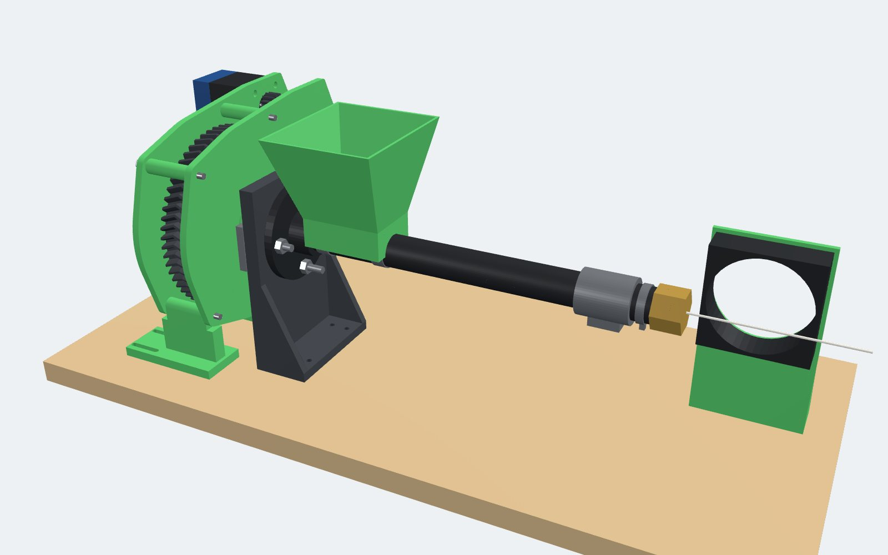

*Left to right: motors (2× NEMA 17 + SERVO42D), printed 20:1 gearbox on slotted feet, thrust bar and bearing, bulkhead, floor flange, hopper, barrel (3/4″ black pipe), band heater (24 V 150 W), thermocouple, die (drilled brass cap), cooling fan.*

| Spec | Value |
|---|---|
| Screw | 3/4″ ship auger, ~293 mm flighted, L/D ≈ 15 |
| Drive | 2× NEMA 17 → 20:1 → ~12 N·m, 15 RPM |
| Heat | 24 V, 150 W band, ESP32 PID |
| Die | 1.75 mm, drilled brass cap |
| Axis height | 110 mm above the base |
| Footprint | 620 × 300 mm plywood |

> [!NOTE]
> The interactive version of this manual, with a rotatable 3D model, is in [`docs/`](docs/). The printed-part files (STL/STEP) are not in this repository yet.

## Contents

- [How it works](#how-it-works)
- [Before you start](#before-you-start)
- [Parts](#parts)
- [Part P: Prep work](#part-p-prep-work)
- [Part G: Gearbox](#part-g-gearbox)
- [Part F: Frame and barrel](#part-f-frame-and-barrel)
- [Part H: Hopper, heat, cooling](#part-h-hopper-heat-cooling)
- [Part W: Wiring](#part-w-wiring)
- [Part S: Firmware rules](#part-s-firmware-rules)
- [Part C: First run](#part-c-first-run)
- [Running it](#running-it)
- [Troubleshooting](#troubleshooting)
- [Key dimensions](#key-dimensions)

## How it works

Cut down the middle, the machine is one straight line from motor to die. Pellets drop through the hopper into the screw, get carried forward and melted, and leave through the die as filament.

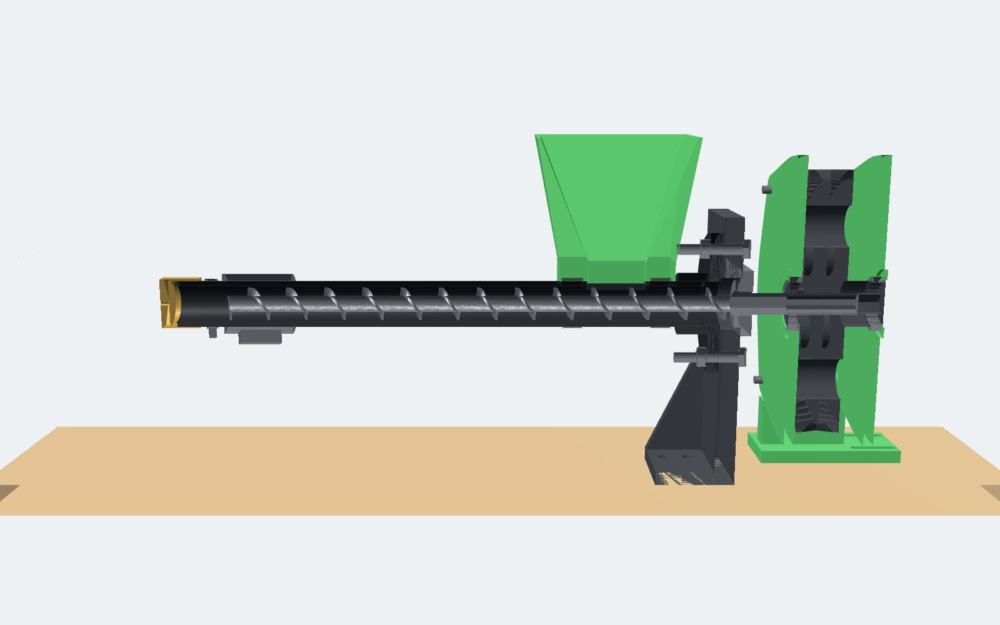

*Cutaway, die at the left. Right to left: the hex shank sits in the output gear of the 20:1 gear train, the thrust bearing takes the push-back, pellets drop in at the feed throat, the flight carries and compacts them, they melt in the zone under the heater, and the melt leaves through the 1.75 mm die.*

The screw pushes plastic forward, so the plastic pushes the screw back toward the motors with up to a few kilonewtons. That load goes through the thrust bearing into the steel thrust bar and the flange bolts. The gearbox only twists the auger: the hex is a slip fit, so none of that push reaches the printed gears.

## Before you start

### Safety

- The barrel runs at 180–200 °C and stays hot for more than 30 minutes after power-off. Touch it only with heat gloves.
- Never run the heater without all three protections: the firmware cutoffs, the 240 °C thermal fuse, and the supply's current limit.
- Everything on the machine is 24 V DC. Only the bench supply plugs into the wall.
- At the output the gearbox makes about 12 N·m. Keep fingers out of the hopper throat while the screw turns, and power off before clearing a jam.
- Wear eye protection when cutting steel, and a mask when drilling PAHT-CF; its dust is fine carbon fiber.
- Run it in a ventilated room, and never leave it unattended while it's hot.

### Tools

- Drill (a drill press is much better for the die and the thrust bar)
- Bits: 1.75 mm, 1/4″, 17/64″, 9/16″ (or a step bit), plus a center punch
- Hacksaw or angle grinder, and a Dremel with cutoff wheels
- Two pipe wrenches (or a vise and one wrench), a file, a deburring tool
- Calipers, multimeter, crimper, hex keys (2.5 and 4 mm), 7/16″ and 13 mm wrenches
- Soldering iron for the heat-set inserts, and a luggage scale for the torque test

**Reading the step renders:** the parts added in each step are shown in full color, and everything already installed is faded.

## Parts

Purchased parts follow the master BOM, plus a plywood base and wood screws. Parts 08–11 and the M3 × 10 version of 03b were added for this version.

### Printed parts

| # | Printed part | Qty | Material | Print notes |
|---|---|---|---|---|
| 00 | Fit-test coupon | 1 | PAHT-CF | Print first. Checks the bearing pockets, hex, D-shaft and insert holes. |
| 01 | Motor pinion 15T | 2 | PAHT-CF | Hub up |
| 02 | Compound gear 75T + 15T | 1 | PAHT-CF | 75T face down |
| 03a | Output gear 60T, rear half | 1 | PAHT-CF | Apex face down, no supports |
| 03b | Output gear 60T, front half (M3 × 10) | 1 | PAHT-CF | Apex face down. If you printed the earlier version, see [P1](#p1-deepen-the-output-gear-counterbores-earlier-03b-only). |
| 04 / 05 | Back plate, front plate | 1 + 1 | PETG or PAHT-CF | Inner face down |
| 06 | Standoff 41 mm | 4 | PETG | The lower two are swapped for the feet in [F4](#f4-mount-the-gearbox) |
| 07 | Axle spacer 1 mm | 2 | PAHT-CF | |
| 08a / 08b | Gearbox feet A and B (new) | 1 + 1 | PETG | As exported, tab on the bed |
| 09 | Bulkhead (new) | 1 | PAHT-CF | Motor-side face down. 5 walls, 40% gyroid. It touches the steel flange, which gets warm. |
| 10 | Hopper (new) | 1 | PETG | As exported, upside down on its rim. No supports. |
| 11 | Fan stand (new) | 1 | PETG | As exported, flat |

### Gearbox hardware

- 2× NEMA 17 + MKS SERVO42D, 2× 608, 2× 6705-2RS
- 8× M3 heat-set inserts, 2× M3 × 4 set screws
- 6× M3 × 10 socket-head screws (output gear halves)
- Motor screws: see [G1](#g1-bearings-and-motors)
- M8 × 70 bolt, nylock nut, 2 washers
- 4× M5 × 60 with nuts and washers; PTFE grease

### Barrel, thrust, frame

- Irwin 47412 3/4″ × 17″ ship auger
- 3/4″ × 12″ black nipple, 3/4″ black floor flange, 3/4″ brass cap, PTFE tape
- AXK1528 needle thrust bearing with both washers
- 102 mm (4″) cut from the 1/4″ × 1.5″ steel bar
- 4× 1/4-20 × 1.5″ bolts with nuts and washers
- 3/4″ plywood, about 620 × 300 mm (new)
- About 12 #8 × 3/4″ pan-head wood screws (new)

### Hopper, heat, cooling

- 3 stainless hose clamps: 2 for the hopper, 1 for the thermocouple
- 24 V 150 W band heater, K-type ring thermocouple
- 240 °C thermal fuse and 2 bare butt splices
- Woodstove gasket rope, Kapton tape
- 24 V 80 mm fan and 4 fan screws

### Power and control

- Bench supply, inline 15 A fuse, latching e-stop (NC)
- MAX31855 amplifier, MOSFET module, ESP32, potentiometer
- 14 AWG silicone wire, ring terminals, lever connectors, jumpers

> [!WARNING]
> **Measure these before printing parts 08–09.** Four dimensions are set from typical values. If yours differ, change that dimension in CAD and re-export the part before printing.

| Measure | Design value | Affects |
|---|---|---|
| Auger hex shank, across the flats | 11.11 mm (7/16″) | Output gear hex bore |
| Auger shank length, from where the flight starts to the end of the hex | 44–94 mm works | Gearbox position ([F4](#f4-mount-the-gearbox)) |
| Floor flange: center-to-center distance of opposite bolt holes | 63.5 mm | Bulkhead and thrust bar holes |
| Motor shaft length past the motor face | ≥ 23 mm | Pinion set screw reach |

## Part P: Prep work

Do the cutting and drilling first, so assembly is just fitting parts together.

### P1: Deepen the output-gear counterbores (earlier 03b only)

1. If your front half is the earlier version, its six screw counterbores are 3 mm deep. They need to be 6 mm for M3 × 10 screws.
2. Clamp it face up on scrap wood. Put a tape flag on a 1/4″ bit 6 mm from where the cutting edges start.
3. Drill at low speed with light pressure, backing out to clear chips. Test one counterbore with a screw before doing the other five.

### P2: Heat-set inserts

1. Pinions: one insert per hub, flush with the outside. Use short inserts so they don't poke into the 5 mm bore.
2. Output rear half: six inserts in the apex face, pressed in straight and flush.

### P3: Thrust bar

1. Cut 102 mm (4″) from the 1/4″ × 1.5″ bar and file the ends square.
2. Center-punch, then drill a `9/16″ (14.3 mm)` hole in the middle. It must be smaller than the bearing's 15 mm bore, so the bearing washer sits fully on steel.
3. Drill two `17/64″` holes on the centerline, 31.75 mm each side of center (use your flange's spacing). Clamp the bar and use cutting oil.

### P4: Die

1. Center-punch the middle of one brass cap's flat end and drill `1.75 mm` straight through, ideally on a drill press.
2. Deburr the inside. The other caps are spares for trying different hole sizes later.

### P5: Auger

1. Grind off the threaded lead screw and spur at the tip.
2. Slide the bit into the nipple and spin it by hand. It must turn without rubbing. File down any high spots on the flight edge.
3. Measure the shank (see the table under [Parts](#parts)). Don't cut the flight to length yet; that happens in [F3](#f3-auger-and-thrust-stack).

## Part G: Gearbox

Build it flat on the bench, back plate down, with four standoffs. It mounts to the frame in F4.

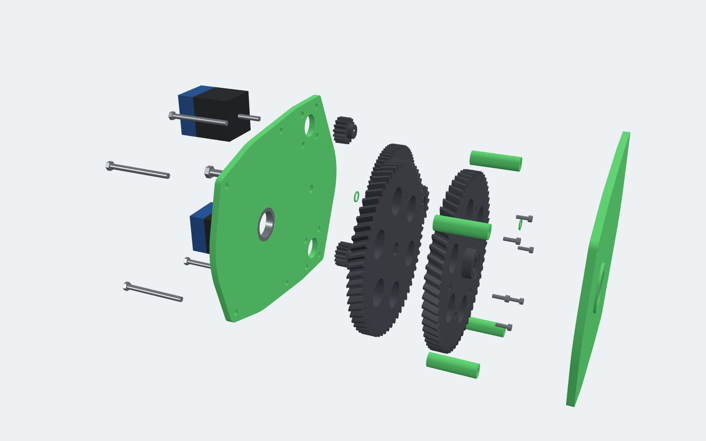

*Gearbox exploded along the auger axis. Stage 1: two 15T pinions drive the shared 75T (5:1). Stage 2: the 15T herringbone drives the 60T output (4:1).*

### G1: Bearings and motors

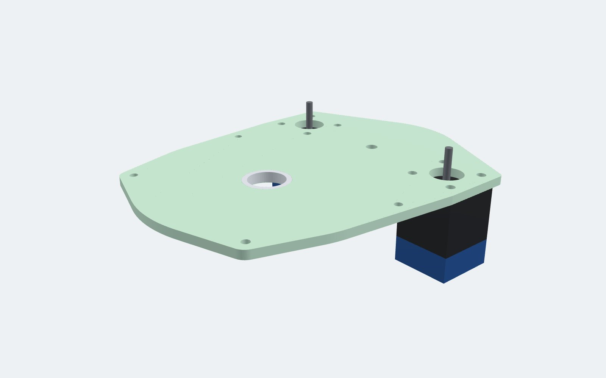

1. Press a 6705 into each plate from the inner face until it seats on the lip. Press a 608 into each end of the compound gear. Push on the outer race only.
2. Set the motors on the outer face of the back plate, bosses in the holes, connectors pointing the same way.
3. The **outer two** screws on each motor are fine as-is.
4. The **inner two** (nearest the M8 axle hole) sit under the 75T gear, which runs only 1 mm above the plate. Either leave them out, or use screws short enough to sit fully inside the counterbores without bottoming on the motor's internal bolts.

**Parts:** 04, 2× 6705, 2× 608, 02, motors, M3 screws

### G2: Pinions, then check direction

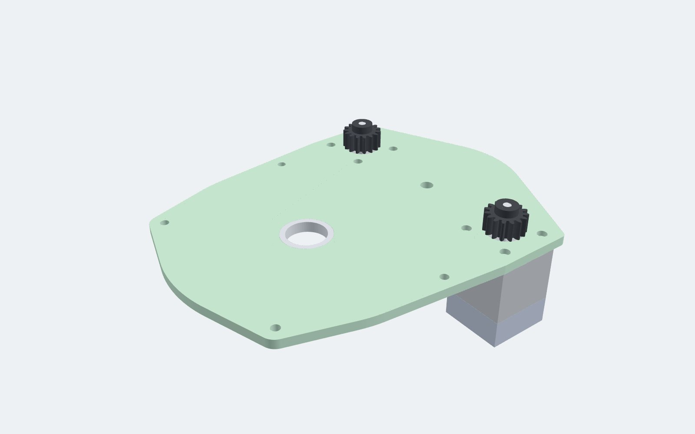

1. Slide each pinion on, hub away from the plate, with the teeth 1 mm above the plate. A 1 mm axle spacer makes a good shim.
2. Tighten the set screw onto the D flat.
3. Wire both drivers to the same STEP/DIR and jog them. Both pinions must turn the same way. If one doesn't, flip its direction in that SERVO42D's menu.

> [!WARNING]
> **Do this check now.** Two motors fighting each other strip teeth within seconds.

**Parts:** 2× 01, 2× M3 × 4 set screws

### G3: Join the output gear

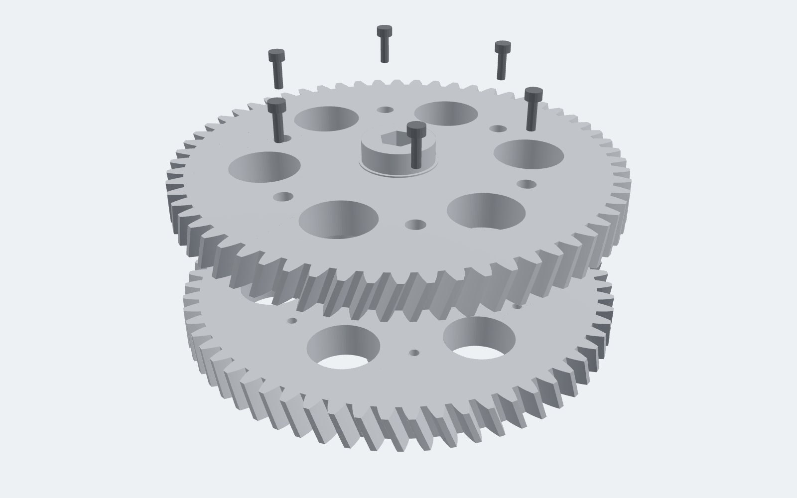

1. Put the apex faces together. Any of the six bolt alignments works; the teeth and the hex line up in all six.
2. Drive 6× M3 × 10 into the inserts, tightening in a star pattern.
3. Push the auger shank through both halves. It should slide in without catching at the seam.

**Parts:** 03a, 03b, 6× M3 × 10

### G4: Drop in the gear pair together

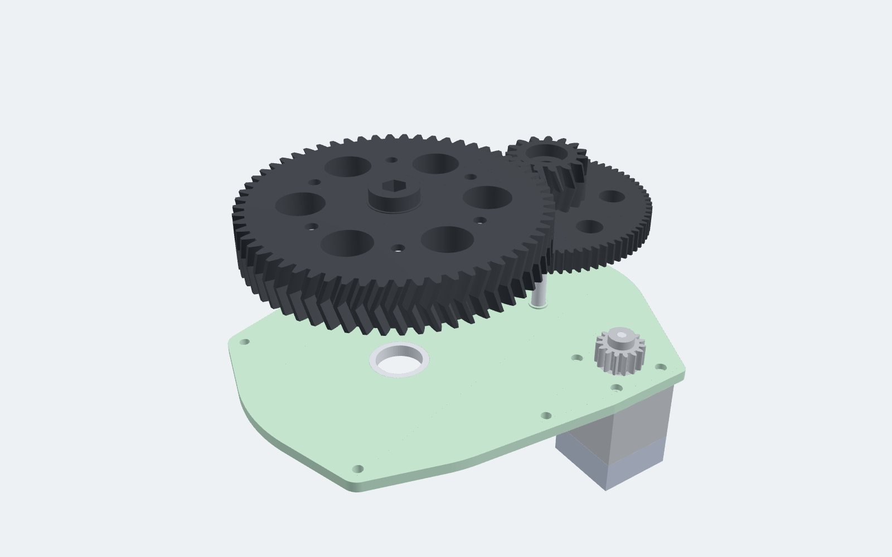

1. Push the M8 bolt and a washer up through the back plate, then put a 1 mm spacer on it.
2. Mesh the compound gear's herringbone 15T with the 60T by hand, with the V apexes level.
3. Lower both at once: the output's rear journal into the back 6705, and the compound gear onto the M8 with the 75T engaging both pinions.
4. Add the second spacer on top.

> [!WARNING]
> **Don't slide one in after the other.** Herringbone teeth can't enter mesh along the axis; they jam.

**Parts:** M8 × 70, washer, 2× 07, 02, output gear

### G5: Standoffs and front plate

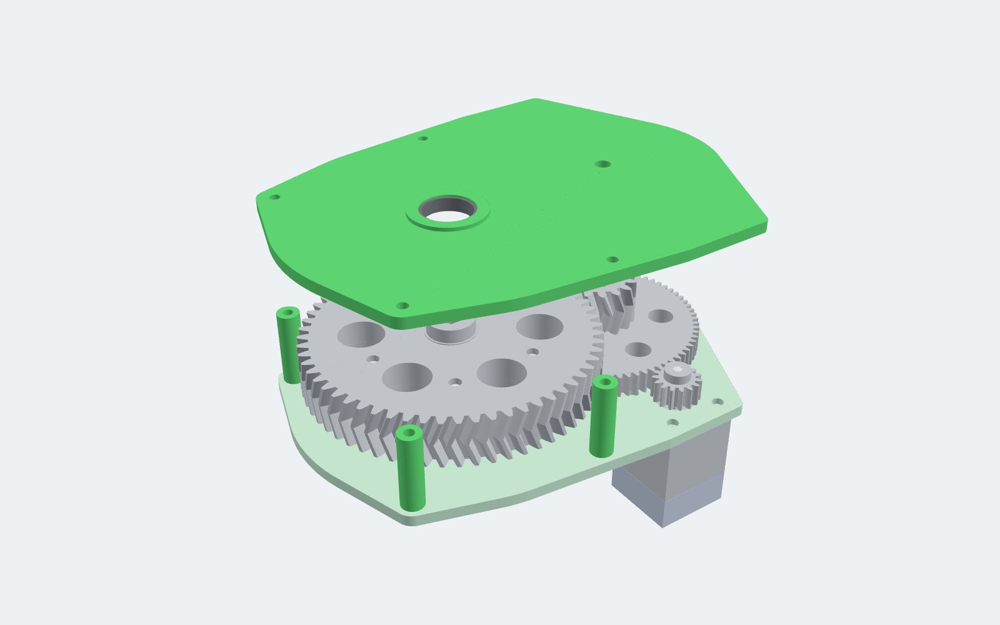

1. Stand four 41 mm standoffs on their holes.
2. Lower the front plate so its 6705 slides over the output's front journal and the M8 comes through.

**Parts:** 05, 4× 06

### G6: Bolt up and test

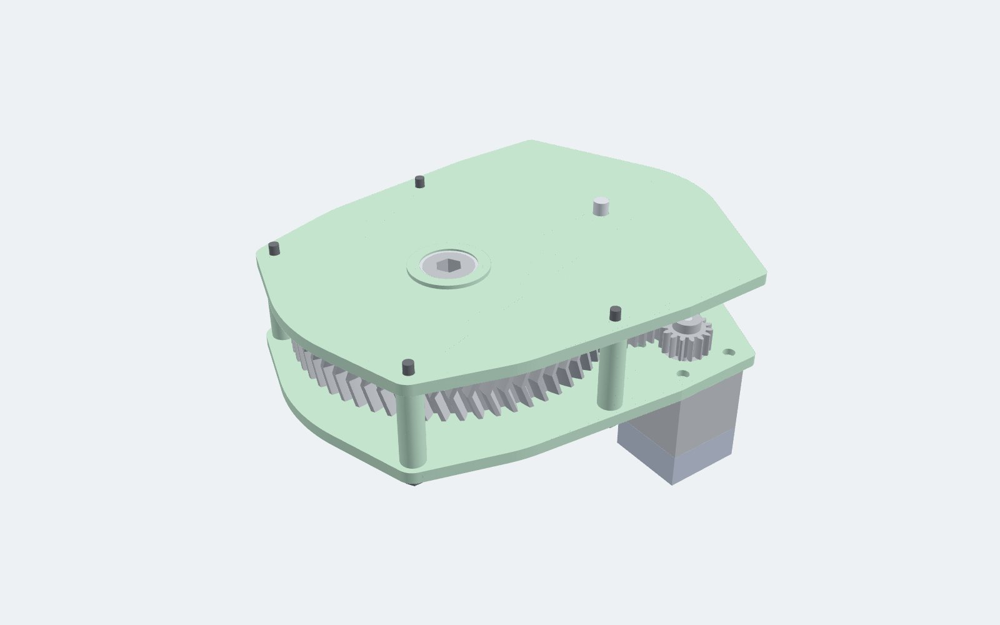

1. Fit 4× M5 × 60 with washers and nuts and tighten in a cross pattern. Tighten the M8 nylock only until snug; it clamps the 608 inner races.
2. Turn the output with a 7/16″ socket. It should feel firm (one output turn is 20 motor turns) and even, with no tight spots.
3. Coat the teeth lightly with PTFE grease. Run the motors slowly first, then at 300 RPM.
4. Torque test: clamp the gearbox, put a 0.5 m lever on the output with a luggage scale at its end, and load it slowly. 2 kg on the scale is about 10 N·m. Stop at the first skip. The prediction is about 12 N·m; record what you measure.

**Parts:** 4× M5 × 60, nuts, washers, M8 nylock, grease

## Part F: Frame and barrel

All machine directions are seen from the front (the long edge you work from): motors on the left, die on the right.

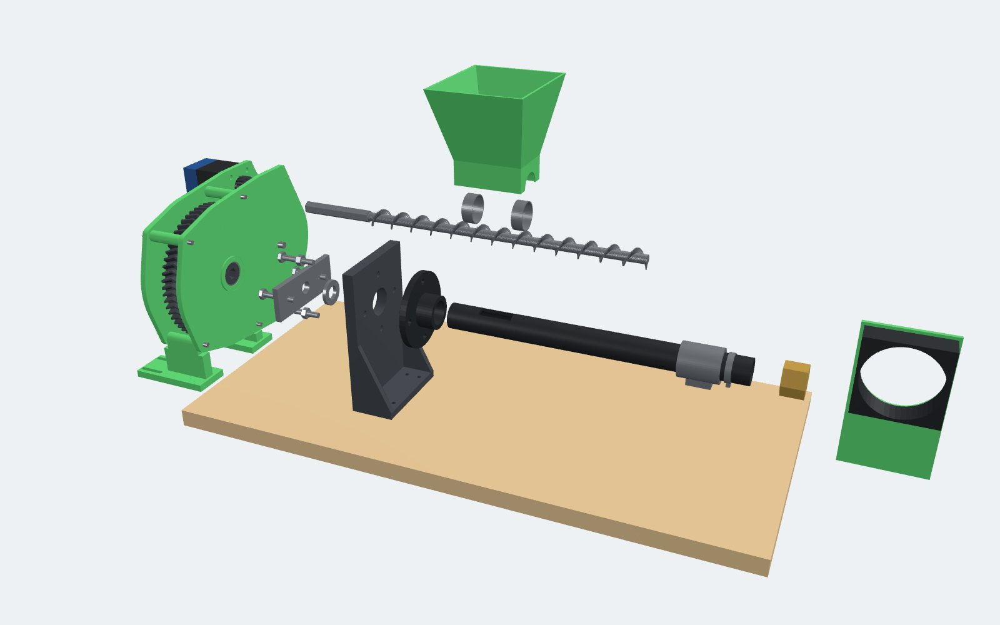

*Whole machine exploded. The auger is lifted out to show it; in the build it slides in from the gearbox side.*

### F1: Base and bulkhead

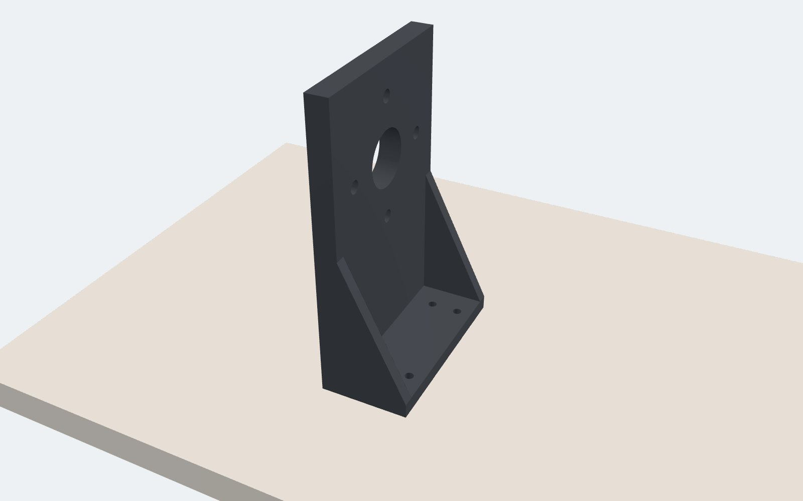

1. Cut the plywood to about 620 × 300 mm.
2. Draw the machine centerline along the board, 120 mm from the front edge. The motors and fan stand sit on the back side.
3. Place the bulkhead on the centerline with its flat motor-side face 170 mm from the left end and its foot pointing right.
4. Square it to the centerline and screw down through the four foot holes with #8 screws and washers.

**Parts:** plywood, 09, 4× #8 wood screws

### F2: Barrel and feed slot

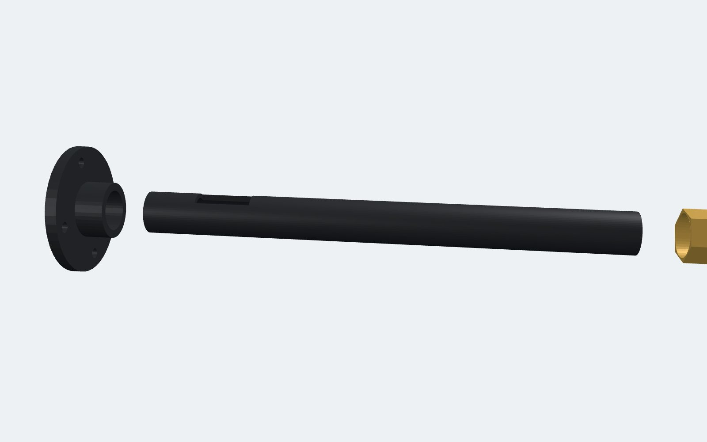

1. Wrap 3–4 turns of PTFE tape on the nipple's threads. Tighten the flange onto one end with two pipe wrenches. Leave the cap off until F3.
2. The screw's drag tends to unscrew the pipe from the flange, so make that joint properly tight.
3. Hold the flange with one pair of bolt holes level, so you know which side of the pipe will be on top. Mark the top of the pipe, starting 18 mm past the end of the flange hub.
4. Cut the feed slot there: 35 mm long and 16 mm wide, through the top wall. Deburr the inside edges carefully, because a burr will catch the auger flight.

**Parts:** nipple, flange, PTFE tape

### F3: Auger and thrust stack

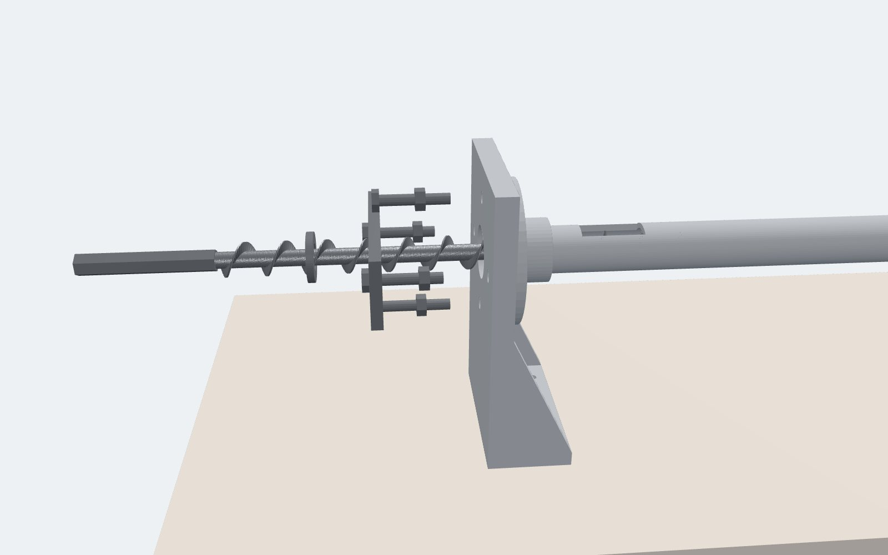

1. Bolt the flange to the bulkhead's right face with the slot on top, using the top and bottom bolt holes. Bolt heads go on the motor side.
2. Slide the thrust bearing (washer, needle cage, washer) onto the auger shank until it rests against the start of the flight.
3. Feed the auger in from the motor side, through the bulkhead and flange and into the barrel.
4. Put the thrust bar over the shank, then bolt it through the bulkhead and flange with the two level bolts. Tighten evenly. The auger should still spin by hand with the bearing seated.
5. Look in the open end of the pipe. The flight should stop about 30 mm short of the end. If it's longer, mark it, pull the auger, and cut the extra with an angle grinder.
6. Tape the threads and tighten the drilled cap onto the open end.

**Parts:** auger, AXK1528, thrust bar, 4× 1/4-20 bolts, nuts, washers, drilled cap

### F4: Mount the gearbox

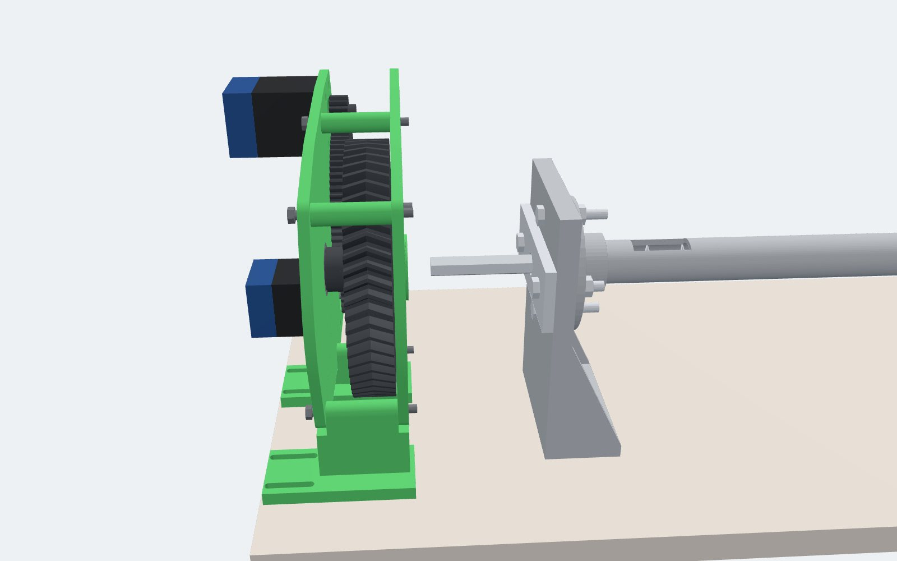

1. Swap the two lower standoffs for feet A and B, one at a time. Pull one M5 bolt, slide the standoff out, slide the foot in, and rebolt.
2. Set the gearbox on the base and slide its output onto the auger's hex.
3. Push the gearbox toward the bulkhead until the shank bottoms in the output gear, then back it off 3 mm. The shank must never touch the bottom, or the gears take the thrust.
4. Check that at least 25 mm of hex is engaged. The foot slots allow ±12 mm of travel.
5. Line the gearbox up by eye along the centerline and screw the feet down through the slots. Shim under the feet if the axis sits low.

**Parts:** 08a, 08b, 4× #8 wood screws

## Part H: Hopper, heat, cooling

### H1: Hopper

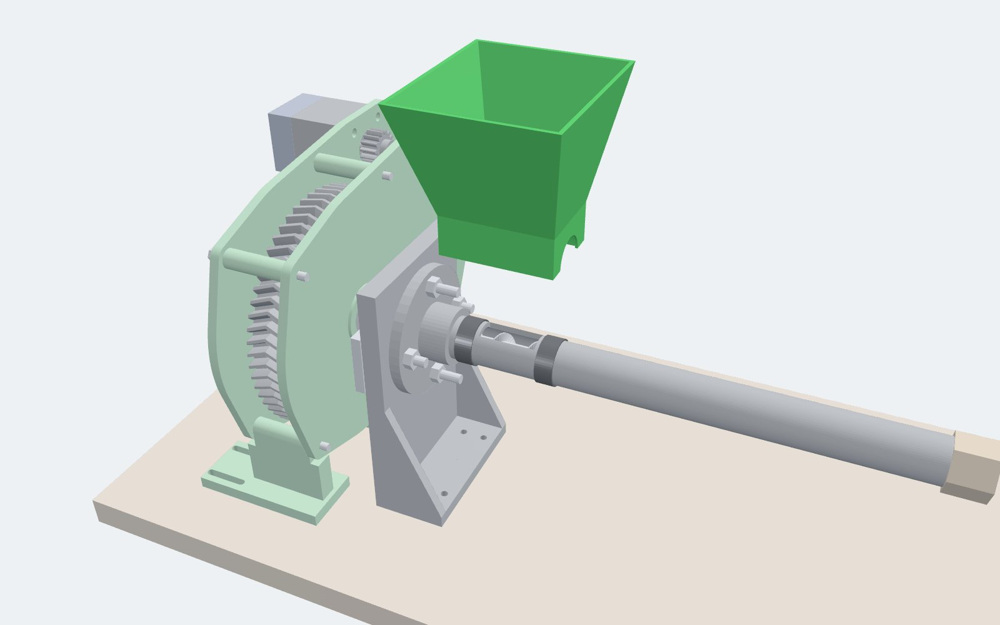

1. Set the hopper on the barrel with its throat over the feed slot.
2. Run a hose clamp through each of its two grooves and around the pipe, with the worm screw underneath. Tighten until the hopper can't rotate.

**Parts:** 10, 2× hose clamps

### H2: Heater, sensor, insulation, fan

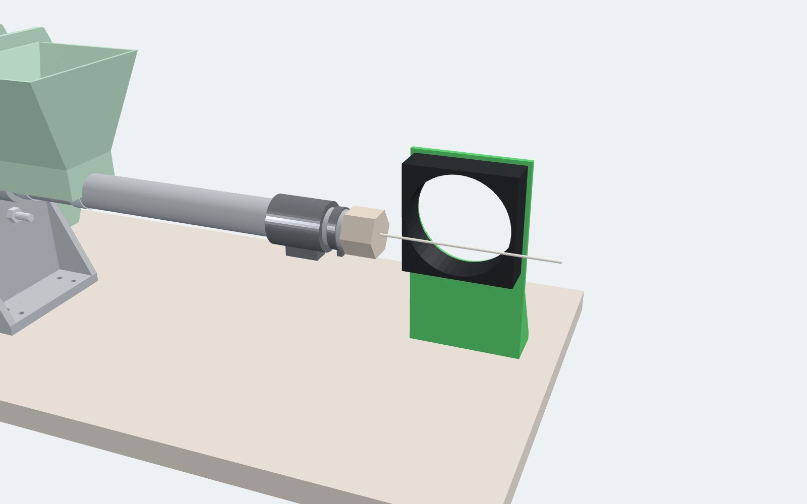

1. **Heater:** clamp the band heater about 14 mm back from the cap, terminals pointing down.
2. **Thermocouple:** clamp the ring between the heater and the cap with a hose clamp. This is the melt temperature the firmware controls.
3. **Thermal fuse:** clamp it to the barrel right next to the heater, wired in series with one heater lead. Join it with bare butt splices; soldering would trip it.
4. **Insulation:** wrap gasket rope from about 40 mm past the feed slot to the cap, over the heater and sensor, and bind it with Kapton tape. Leave the feed zone bare so pellets don't soften and stick there.
5. **Fan:** screw the fan to the stand so it blows across the filament path. Screw the stand down with its plate just past the die.

**Parts:** heater, thermocouple, thermal fuse, splices, rope, Kapton, 11, fan

## Part W: Wiring

One 24 V supply runs everything. The e-stop cuts all of it.

| ESP32 pin | Connects to |
|---|---|
| GPIO25 / 26 / 27 | STEP / DIR / EN on **both** SERVO42Ds, in parallel |
| GPIO23 | MOSFET module TRIG (PWM) |
| GPIO5 / 18 / 19 | MAX31855 CS / CLK / DO; MAX31855 VIN to 3V3 |
| GPIO34 | Speed potentiometer wiper (pot across 3V3 and GND) |
| GND | Supply GND (common ground) and MOSFET signal GND |

- Set both SERVO42Ds to the same microstep and current. At 16 microsteps, 300 motor RPM is a 16 kHz step rate. Check the SERVO42D manual for its input logic level; if it needs 5 V, add a level shifter on STEP/DIR/EN.
- If the thermocouple reading drops when the barrel heats, swap its two leads. Crimp a ring terminal to a GND wire and put it under a flange nut, so a chafed heater lead can't leave the barrel live.

## Part S: Firmware rules

The firmware has to do everything a commercial temperature controller would, plus keep the screw from turning cold plastic. These are the requirements the code has to meet.

| Behavior | Rule |
|---|---|
| Heater control | PID on the MAX31855 reading, with slow PWM (about 1 Hz; the barrel has a lot of thermal mass). PLA setpoint 175–185 °C. |
| Over-temperature (latching) | Heater off if the reading passes 230 °C |
| Heating watchdog (latching) | Heater off if it has been on for 60 s and the temperature rose less than 5 °C |
| Sensor fault (latching) | Heater off on any MAX31855 fault (open, short) or an out-of-range reading |
| Cold-screw interlock | The screw won't turn until the barrel is within 5 °C of setpoint and has stayed there for 10 minutes |
| Speed | The potentiometer sets 0–15 screw RPM (0–300 motor RPM), ramped, never stepped |
| Logging | Once a second over USB: temperature, setpoint, PWM %, screw RPM |

## Part C: First run

Work through these in order, and don't put pellets in until C4.

| # | Check | Pass when |
|---|---|---|
| C1 | Cold spin, empty: screw at 5 RPM. Viewed from the motor end, a right-hand auger must turn clockwise, like a drill. | No rubbing or clicking, and the flight moves toward the die. If not, flip DIR in software (both drivers together). |
| C2 | Electrical: supply at 24.0 V, limit 9.5 A. Measure heater resistance through the thermal fuse, and continuity from barrel to GND. | About 3.8 Ω, and the barrel is grounded |
| C3 | Heater, empty barrel: 100 °C, then 180 °C. Tune the PID. Then trip each cutoff on purpose: unplug the thermocouple, and disconnect a heater lead while it heats. | Overshoot under about 5 °C, and every cutoff shuts the heater off |
| C4 | Heat soak at 180 °C for 10 minutes. Load dried PLA (4 h at 50–55 °C) to a third of the hopper. Screw at 5 RPM. | Purge comes out (it may be dark or bubbly at first), then runs clean |
| C5 | Pull by hand at an even pace past the fan. Measure with calipers every 30 cm, and record RPM, temperature and pull speed. | Diameter is roughly steady. ±0.05 mm needs the v2 puller. |

## Running it

**Start**

- Heat to setpoint and wait 10 minutes after it gets there.
- Start the screw slowly and ramp up.
- Keep the hopper at least a third full. Running it low causes surging.

**Stop**

- Stop feeding pellets and run until the output thins.
- Stop the screw, then turn the heater off. Leave the fan on until the barrel is under 60 °C.
- Next time, always heat-soak fully before turning the screw. Cold PLA in the barrel will stall the gearbox.

When switching materials or additive blends, purge with plain PLA until the output is clean, and log the purge mass. It tells you how long the barrel takes to clear, which you'll need when comparing blends.

## Troubleshooting

| Symptom | Likely cause | Fix |
|---|---|---|
| Screw turns, nothing comes out | Pellets bridging in the throat because the feed zone is too warm | Keep the feed zone uninsulated and aim airflow at the throat. Check the slot isn't blocked. |
| Motors stall or skip | Barrel not fully soaked, RPM too high, or the die is blocked | Finish the soak, lower RPM, clear the die |
| Output surges thick and thin | Temperature swinging, hopper running low, uneven pulling | Retune the PID, keep the hopper fed. The v2 puller fixes the pulling. |
| Bubbles, popping | Wet pellets | Dry them 4 h at 50–55 °C |
| Brown or smoky output | Too hot, or sitting hot too long | Drop 5–10 °C. Don't idle at temperature. |
| Filament too thin or too thick | Pull speed doesn't match the flow | Pull slower or faster. Try another cap with a different hole. |
| Clicking from the gearbox | Inner motor screw heads touching the 75T, or dry teeth | Recheck [G1](#g1-bearings-and-motors), then grease |
| Auger grinds or rubs | Gearbox out of line with the bulkhead, or a burr in the barrel | Realign the feet, deburr the slot edges |
| Pipe works loose from the flange | Screw drag unthreads it | Re-tape and retighten. Add a pipe strap at mid-barrel if it keeps happening. |
| Thermal fuse blew | The firmware failed to stop the heater | Find out why before replacing the fuse |

## Key dimensions

Positions along the auger axis, measured from the inner face of the gearbox back plate. The axis sits 110 mm above the base.

| Item | Axial position (mm) |
|---|---|
| Auger hex tip (3 mm off the gear's hex floor) | ≈ −3 |
| Gearbox front face (bearing boss) | 49 |
| Thrust bar | 69 – 75 |
| Thrust bearing, start of flight | 75 – 79 |
| Bulkhead | 75 – 87 |
| Floor flange (base, hub) | 87 – 112 |
| Feed slot / hopper throat | 130 – 165 |
| Band heater | 335 – 375 |
| End of flight | ≈ 372 |
| Thermocouple | ≈ 380 |
| Brass cap / die face | 389 – 411 |
| Fan center | 455 |

These assume the gearbox sits in the middle of its slot travel. Your auger's shank length moves the gearbox by up to ±12 mm; nothing else changes.

---

*Build manual and renders built by hand in Onshape (CAD) then organized by Claude (anthropic)*
